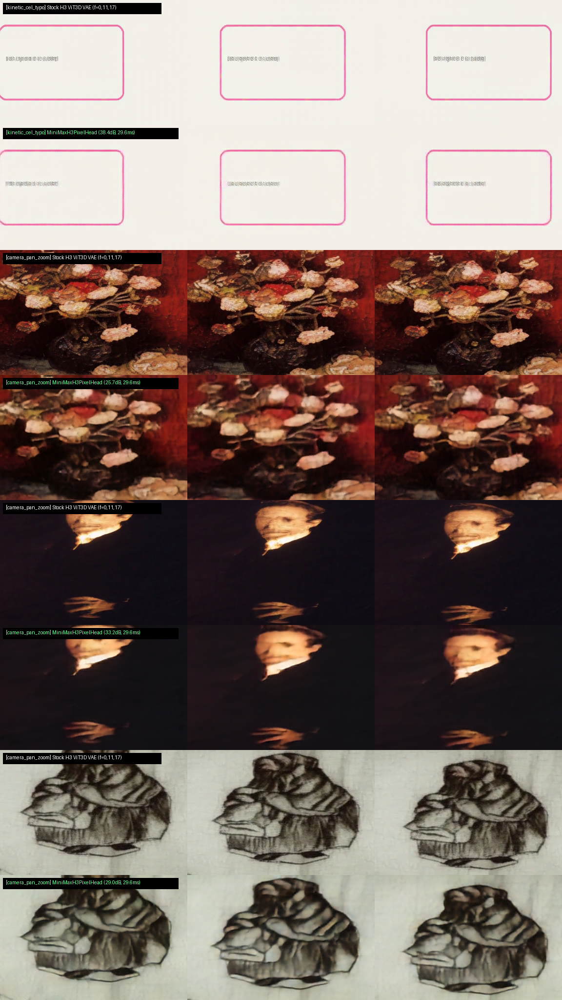

<div align="center">

# 🧪 ComfyUI-MiniMaxH3-PixelHead *(Experimental Preview `v0.2.0`)*

**Zero-Video-VAE 3D Non-Uniform `(1,4,4,4,4)` Direct Pixel Readout Head for MiniMax-H3 (`45.7 MiB` BF16 vs `2.68 GB` ViT3D VAE · `8.5×` Faster)**

[**English**](README.md) | [**简体中文**](README_zh.md)

[-orange)](#%EF%B8%8F-current-known-issues--why-not-recommended-yet)
[](LICENSE)
[](https://huggingface.co/pocis/MiniMax-H3-Video-PixelHead)
[](https://registry.comfy.org/publishers/wither033/nodes/comfyui-minimaxh3-pixelhead)

</div>

> [!WARNING]
> **⚠️ EXPERIMENTAL PREVIEW — NOT RECOMMENDED FOR PRODUCTION USE YET (PLEASE WAIT FOR UPCOMING `v3 Sharp` OPTIMIZATION)**
>
> We are releasing this **`v0.2.0` (`v2` Overcomplete)** checkpoint early as an **open research baseline and ultra-low-VRAM layout preview tool**, NOT as a drop-in production replacement for the official `2.68 GB` MiniMax-H3 ViT3D Video VAE:
> - **Current Limitation**: While color, structure, `(1, 4, 4, 4, 4)` non-uniform frame timing (`17k + 5` frames), and flat 2D cel/typography (`36.73 dB` PSNR) reconstruct cleanly, **complex natural micro-textures (fine facial features, dense impasto brushstrokes, foliage, and fast foreground parallax occlusion at `25.91 dB` / `LPIPS 0.29–0.37`) suffer from noticeable high-frequency over-smoothing ("plastic/soft-focus blur")**.
> - **Recommendation**: **Do NOT use this preview checkpoint for final production video delivery.** Keep using our production-ready 2D PixelHeads (**[Qwen-Image 2.1](https://github.com/Wither033/ComfyUI-QwenImage21-PixelHead)** & **[Krea-2](https://github.com/Wither033/ComfyUI-Krea2-PixelHead)**), and please watch/star this repository for the upcoming **`v3 Sharp`** release (adding multi-scale LPIPS-VGG + FFT perceptual sharpening and native `16px`-grid `x0_hat_vid` injection).

---

## 🔍 Transparent Visual & Quantitative Benchmark (`384×256×22f`, NVIDIA L4)

Evaluated honestly on 20 held-out 22-frame (`T_lat = 7`, spanning two `(1, 4, 4, 4, 4)` temporal cycles: `f = 0, 11, 17` shown below) test clips against the official `minimax_h3_video_vae_int8_convrot.safetensors` (`36`-layer `ViT3DDecoder`):

| Video Decoder | Weight Size | Median Clip Latency | Speedup | Overall PSNR (↑) | Real-Texture PSNR | LPIPS-VGG (↓) | Status |
| :--- | :---: | :---: | :---: | :---: | :---: | :---: | :---: |
| **Official `minimax_h3_video_vae` (36-Layer ViT3D)** | `2680.8 MiB` | `251.30 ms` | `1.0×` | *(Reference)* | *(Reference)* | `0.0000` | ✅ Production |
| **`MiniMaxH3VideoPixelHead` (`v0.2.0` Preview)** | **`45.7 MiB` (BF16)** / `91.4 MiB` (FP32) | **`29.59 ms`** | **`8.5×`** | `31.03 dB` *(inflated by cel/typo)* | **`25.91 – 30.13 dB`** | **`0.2338`** *(`0.29–0.37` on art/photo)* | ⚠️ **Preview Only** |

### Per-Regime Breakdown (Showing Where It Works vs. Where It Blurs)

| Motion & Texture Regime | Held-Out PSNR (↑) | LPIPS-VGG (↓) | Honest Visual Assessment |
| :--- | :---: | :---: | :--- |
| `kinetic_cel_typo` *(Flat 2D cel & moving text)* | `36.73 dB` | `0.0547` | Clean edges & colors; pulls the overall mean up to `31.03 dB`. |
| `camera_pan_zoom` *(Natural art/photo pan & zoom)* | `30.13 dB` | `0.2923` | Global lighting & motion match, but fine brushstrokes & eyes are visibly smoothed (`25.7–33.2 dB`). |
| `static_lockoff` *(Stationary fine textures)* | `29.17 dB` | `0.3059` | Temporally stable, but high-frequency grain/charcoal texture is softened. |
| `parallax_occlusion` *(Fast foreground occlusion)* | **`25.91 dB`** | **`0.3677`** | **Weakest regime**: moving occlusion boundaries exhibit noticeable softness. |



---

## ⚠️ Current Known Issues & Why Not Recommended Yet (Root-Cause Diagnosis)

We analyzed `comfy/ldm/minimax/vae.py` and our `v2` training run to pinpoint the exact four causes behind the texture softness (all scheduled to be fixed in **`v3 Sharp`**):

1. **`16×` Heavier Per-Token Decompression vs. 2D Image PixelHeads**:
   - In 2D image DiTs (`Qwen-Image 2.1`, `Krea-2`), 1 DiT token reconstructs `16×16 = 256` pixels.
   - In `MiniMax-H3`, the `16×` spatial VAE combined with DiT `patch_size = (1, 2, 2)` requires **1 DiT token to reconstruct `4 × 32 × 32 = 4,096` pixels (`16×` more pixels!)**, where the stock decoder uses a massive **36-layer, 2048-dim global-attention `ViT3D`** (`2.68 GB` INT8 / `5.3 GB` BF16), while this preview head uses only `23.96M` parameters (`width = 768`).
2. **Pure Pixel-Space `MSE` Regression Under High Terminal Noise ($\sigma_{\text{last}} = 0.6316$)**:
   - Under `video_shift = 12.0`, 8-step sampling starts its final denoising step at $\sigma_{\text{last}} = 0.6316$. Without perceptual `LPIPS-VGG` / frequency-domain supervision during training, minimizing `5.0 × MSE` mathematically drives a compact ConvNeXt trunk to output the **smooth conditional mean** over uncertain micro-textures.
3. **Suboptimal `x0_hat_vid` Spatial Injection Grid**:
   - `x0_hat_vid` (`[B, 24, T_lat, H_lat, W_lat]`) already lives natively on the finer **`16px` spatial grid**, yet `v0.2.0` patchified it `2×2` down to the `32px` entry stage instead of injecting it directly at the `16px` (`s16`) stage.
4. **Limited Natural-Texture Calibration Diversity**:
   - Trained for `1,800` rollouts on `280` clips at `384×256` (with `25%` synthetic flat cel/typography); loss was still descending at rollout `1,800`.

---

## 🌐 FastFrames Zero-VAE Direct PixelHead Ecosystem

| Target Model | Status | ComfyUI Custom Node (GitHub & Registry) | Hugging Face Weights | Key Specs & Speedup |
| :--- | :---: | :--- | :--- | :--- |
| **Qwen-Image 2.1** (`1×` & `2×` SR) | ✅ **Recommended** | **[Wither033/ComfyUI-QwenImage21-PixelHead](https://github.com/Wither033/ComfyUI-QwenImage21-PixelHead)** | **[pocis/Qwen-Image-2.1-PixelHead](https://huggingface.co/pocis/Qwen-Image-2.1-PixelHead)** | `48.8 MiB` (`1×`) / `52.1 MiB` (`1×`+`2×` `2048px`) · **4-Ch RGBA** · **`67.1×` faster** (`5.55 ms`, `33.91 dB`) |
| **Krea-2** (`Turbo` & `Raw`) | ✅ **Recommended** | **[Wither033/ComfyUI-Krea2-PixelHead](https://github.com/Wither033/ComfyUI-Krea2-PixelHead)** | **[pocis/Krea-2-PixelHead](https://huggingface.co/pocis/Krea-2-PixelHead)** | `52.6 MiB` BF16 · `6144d` Bridged RGB · **`24.7×` faster** (`33.33 dB` PSNR, up to `41.6 dB` on portraits) |
| **MiniMax-H3** *(3D Video)* *(This Repo)* | ⚠️ **Preview Only** | **[Wither033/ComfyUI-MiniMaxH3-PixelHead](https://github.com/Wither033/ComfyUI-MiniMaxH3-PixelHead)** | **[pocis/MiniMax-H3-Video-PixelHead](https://huggingface.co/pocis/MiniMax-H3-Video-PixelHead)** | `45.7 MiB` BF16 · `(1,4,4,4,4)` Causal 3D · `8.5×` faster (`31.03 dB` mean, soft high-freq; **`v3 Sharp` upcoming**) |
| **Training Toolkit & Playbook** | 📚 **Framework** | **[Wither033/FastFrames-PixelHead-Trainer](https://github.com/Wither033/FastFrames-PixelHead-Trainer)** | **[HF Unified Collection](https://huggingface.co/collections/pocis/fastframes-zero-vae-direct-pixelheads-comfyui-6b031df8e9212f8bae294154)** | Full DiT surgery methodology, debugging post-mortems, `pixelhead_trainer` & 5 Colab L4 notebooks |

---

## 🧪 For Researchers & Low-VRAM Layout Drafting: Installation

If you still wish to inspect this experimental preview for research comparison or Zero-Video-VAE motion/layout drafting:

1. **Install Node**:
   ```bash
   cd ComfyUI/custom_nodes
   git clone https://github.com/Wither033/ComfyUI-MiniMaxH3-PixelHead.git
   ```
   *(Or via `comfy node install comfyui-minimaxh3-pixelhead`.)*
2. **Download Experimental Preview Weights** from **[pocis/MiniMax-H3-Video-PixelHead](https://huggingface.co/pocis/MiniMax-H3-Video-PixelHead)** into `ComfyUI/models/pixel_heads/`:
   - `minimax_h3_video_pixel_head_bf16.safetensors` (`45.7 MiB`)
   - `minimax_h3_video_pixel_head.safetensors` (`91.4 MiB` FP32)
3. **Example Workflows**: Included in [`example_workflows/`](example_workflows/) (`01_MiniMaxH3_VideoPixelHead_Preview_EN.json` & `01_MiniMaxH3_VideoPixelHead_Preview_ZH.json`). Insert **`MiniMax-H3 Video Pixel Head Tap`** after `MiniMaxH3SigmaShift`, and connect **`MiniMax-H3 Video Pixel Decode (Zero Video VAE)`** after `SamplerCustomAdvanced`.

---

## 📜 License & Acknowledgments

- **License**: **MIT License** (100% clean-room PyTorch & ComfyUI implementation).
- **Credits**: Inspired by Apple Research [*FastFrames* (`arXiv:2611.23226`)](https://arxiv.org/abs/2611.23226) and community `sorryhyun/anima-pixel-decoder` exploration.
