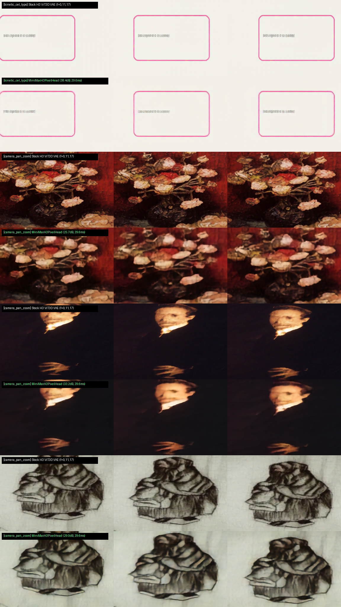

# 🧪 ComfyUI-MiniMaxH3-PixelHead *(实验预览版 `v0.2.0`)*

**MiniMax-H3 免 Video VAE 非均匀时序 `(1,4,4,4,4)` 3D 视频像素直出头（仅 `45.7 MiB` BF16 · 替代 `2.68 GB` ViT3D VAE · 提速 `8.5×`）**

[**English**](README.md) | [**简体中文**](README_zh.md)

[-orange)](#-%E5%BD%93%E5%89%8D%E5%B7%B2%E7%9F%A5%E9%97%AE%E9%A2%98%E4%B8%8E%E4%B8%8D%E6%8E%A8%E8%8D%90%E5%8E%9F%E5%9B%A0%E5%AE%8C%E6%95%B4%E6%8A%80%E6%9C%AF%E8%AF%8A%E6%96%AD)

> [!WARNING]
> **⚠️ 重要提示：当前版本为早期实验预览版（`v0.2.0`），暂不推荐在正式出片/生产环境中使用，请等待后续优化版本（`v3 Sharp`）！**
>
> 本着透明开源的原则，我们将已完成几何与非均匀帧轴验证的 **`v0.2.0`（`v2` 过完备结构）** 先行归档公开，仅供社区进行**算法对照研究或极低显存构图草稿快览**，**目前尚不能无损平替官方 `2.68 GB` 的 36 层 ViT3D Video VAE**：
> - **当前核心缺陷（高频涂抹 / 磨皮感）**：虽然色彩还原、空间几何对齐、`(1, 4, 4, 4, 4)` 跨周期 `17k + 5` 帧时序展开以及扁平 2D 赛璐璐/文字场景（`36.73 dB`）均正常，但在**复杂自然高频纹理（人物细微五官、厚涂油画笔触、植被颗粒）以及快速前景视差遮挡（`25.91 dB`，`LPIPS = 0.29 ~ 0.37`）**场景下，画面存在肉眼可见的**高频柔焦涂抹与塑料磨皮感**。
> - **使用建议**：**正式视频成片请暂勿使用本预览版，请等待我们后续引入多尺度 LPIPS 感知锐化与 `16px` 潜空间原位直注的 `v3 Sharp` 优化版**。若需生产级免 VAE 极速直出，现阶段强烈推荐使用已成熟的 2D 图像同系列作品：**[Qwen-Image 2.1 PixelHead](https://github.com/Wither033/ComfyUI-QwenImage21-PixelHead)** 与 **[Krea-2 PixelHead](https://github.com/Wither033/ComfyUI-Krea2-PixelHead)**。

---

## 🔍 真实评测数据与无修对比图（`384×256×22帧` · NVIDIA L4）

以官方原版 `minimax_h3_video_vae_int8_convrot.safetensors`（36 层 `ViT3DDecoder`）为基准，在 20 段独立留出的 22 帧视频片段（`T_lat = 7`，横跨两个 `(1,4,4,4,4)` 周期，下图展示第 `0`、`11`、`17` 帧）上实测：

| 视频解码方案 | 权重体积 | 单段解码延迟 | 提速比 | 总体均值 PSNR | 真实复杂纹理 PSNR | LPIPS-VGG (↓) | 当前状态 |
| :--- | :---: | :---: | :---: | :---: | :---: | :---: | :---: |
| **官方 `minimax_h3_video_vae` (36层 ViT3D)** | `2680.8 MiB` | `251.30 ms` | `1.0×` | *(基准 Reference)* | *(基准 Reference)* | `0.0000` | ✅ 正式生产 |
| **`MiniMaxH3VideoPixelHead` (`v0.2.0` 预览版)** | **`45.7 MiB` (BF16)** / `91.4 MiB` (FP32) | **`29.59 ms`** | **`8.5×`** | `31.03 dB` *(被纯色字块拉高)* | **`25.91 – 30.13 dB`** | **`0.2338`** *(实景艺术类 `0.29–0.37`)* | ⚠️ **不推荐生产使用** |

### 细分动态场景拆解（清楚展示哪些能看、哪些发糊）

| 运动与纹理类型 | 独立测试集 PSNR (↑) | LPIPS-VGG (↓) | 肉眼真实观感说明 |
| :--- | :---: | :---: | :--- |
| `kinetic_cel_typo` *(纯色块与动态文字)* | `36.73 dB` | `0.0547` | 纯色边缘干净，但这部分高分把整体平均分虚高拉到了 `31.03 dB`。 |
| `camera_pan_zoom` *(艺术油画/实拍平滑推拉摇移)* | `30.13 dB` | `0.2923` | 构图、色彩和运镜一致，但花瓣肌理（下图第 2 组 `25.7 dB`）与人物眉眼明显偏柔焦涂抹。 |
| `static_lockoff` *(固定机位高细节纹理)* | `29.17 dB` | `0.3059` | 帧间稳定不闪烁，但炭笔素描颗粒等高频细节偏软。 |
| `parallax_occlusion` *(前景快速运动遮挡)* | **`25.91 dB`** | **`0.3677`** | **当前最薄弱项**：运动遮挡交界处出现明显模糊退化。 |

---

## ⚠️ 当前已知问题与不推荐原因（完整技术诊断与后续优化路线）

对照 `comfy/ldm/minimax/vae.py` 源码排查后，当前版本效果一般的四大根因已完全明确（将在下一版 **`v3 Sharp`** 中逐项解决）：

1. **单 Token 时空解压负担比 2D 图像头重 `16` 倍**：
   - 在 `Qwen-Image 2.1` 与 `Krea-2` 中，1 个 DiT Token 只需还原 `16×16 = 256` 个像素；
   - 而在 `MiniMax-H3` 中，`16×` 空间 VAE 叠加 DiT 的 `(1, 2, 2)` Patch，导致 **1 个 DiT Token 必须还原 `4帧 × 32×32 = 4,096` 个像素（负担重 16 倍）**。官方解码器动用了 **36 层、`2048` 维全局注意力 `ViT3D`**，而当前预览版仅配了 `width=768`（`23.96M` 参数）。
2. **高末步噪声（$\sigma_{\text{last}} = 0.6316$）下纯像素 `MSE` 损失引发的「回归均值磨皮效应」**：
   - `MiniMax-H3` 在 `video_shift = 12.0` 下的 8 步末步起点噪声高达 `0.6316`。当前版本训练期未挂载 VGG/LPIPS 感知损失与频域损失，在 `5.0 × MSE` 压力下，小网络遇到不确定高频细节时会自动涂成平滑过渡色块来降低平方误差。
3. **`x0_hat_vid` 原生 `16px` 空间分辨率被提前折叠到了 `32px`**：
   - 去噪视频潜变量 `x0_hat_vid`（`[B, 24, T_lat, H_lat, W_lat]`）本身处于更精细的 `16px` 网格，但当前版本在入口将其 `2×2` 打包降采样到了 `32px` 粗网格，损失了一半的潜空间直接定位锐度（后续将在 `s16` 层增加原位跨层直注）。
4. **训练校准集分辨率（`384×256`）与真实纹理覆盖度不足**：
   - 仅在 `280` 段小尺寸合成片段上训了 `1800` Rollouts（其中 `1/4` 为纯色文字块），退火结束时指标仍在上升。

---

## 🌐 FastFrames 免 VAE 极速像素头开源矩阵（同系列联动）

| 适配底座模型 | 推荐状态 | ComfyUI 插件仓（GitHub & 官方注册表） | Hugging Face 权重仓 | 核心规格与实测表现 |
| :--- | :---: | :--- | :--- | :--- |
| **Qwen-Image 2.1**（`1×` 与 `2×` 超分） | ✅ **主力推荐** | **[Wither033/ComfyUI-QwenImage21-PixelHead](https://github.com/Wither033/ComfyUI-QwenImage21-PixelHead)** | **[pocis/Qwen-Image-2.1-PixelHead](https://huggingface.co/pocis/Qwen-Image-2.1-PixelHead)** | `48.8 MiB` (`1×`) / `52.1 MiB` (`1×`+`2×` 直出 `2048`) · **原生 4 通道 RGBA** · **提速 `67.1×`**（均值 `33.91 dB`） |
| **Krea-2**（`Turbo` 与 `Raw`） | ✅ **主力推荐** | **[Wither033/ComfyUI-Krea2-PixelHead](https://github.com/Wither033/ComfyUI-Krea2-PixelHead)** | **[pocis/Krea-2-PixelHead](https://huggingface.co/pocis/Krea-2-PixelHead)** | `52.6 MiB` BF16 · `6144d` 降维桥直出 RGB · **提速 `24.7×`**（均值 `33.33 dB`，肖像达 `37.1~41.6 dB`） |
| **MiniMax-H3** *(3D 视频)* *(当前仓库)* | ⚠️ **实验预览（暂不推荐）** | **[Wither033/ComfyUI-MiniMaxH3-PixelHead](https://github.com/Wither033/ComfyUI-MiniMaxH3-PixelHead)** | **[pocis/MiniMax-H3-Video-PixelHead](https://huggingface.co/pocis/MiniMax-H3-Video-PixelHead)** | `45.7 MiB` BF16 · `(1,4,4,4,4)` 因果 3D · 提速 `8.5×`（高频细节偏糊，**请等待 `v3 Sharp` 优化版**） |
| **通用训练框架与实战手册** | 📚 **方法论总仓** | **[Wither033/FastFrames-PixelHead-Trainer](https://github.com/Wither033/FastFrames-PixelHead-Trainer)** | **[HF 官方统一合集](https://huggingface.co/collections/pocis/fastframes-zero-vae-direct-pixelheads-comfyui-6b031df8e9212f8bae294154)** | 完整公开 5 大底座源码解剖法、踩坑复盘、`pixelhead_trainer` 库与 Colab L4 训练台 |

---

## 🧪 仅供科研对比与极低显存草稿测试：安装说明

如已知悉上述高频模糊局限，仍需用于算法研究或免加载 `2.68 GB` Video VAE 的草稿动作预览：

1. **安装节点**：`git clone https://github.com/Wither033/ComfyUI-MiniMaxH3-PixelHead.git` 至 `ComfyUI/custom_nodes/`（或执行 `comfy node install comfyui-minimaxh3-pixelhead`）。
2. **下载实验权重**：前往 **[pocis/MiniMax-H3-Video-PixelHead](https://huggingface.co/pocis/MiniMax-H3-Video-PixelHead)** 下载 `minimax_h3_video_pixel_head_bf16.safetensors`（`45.7 MiB`）放入 `ComfyUI/models/pixel_heads/`。
3. **测试工作流**：见 [`example_workflows/`](example_workflows/) 目录下的中英文预览工作流。

---

## 📜 开源协议与致谢

- **开源协议**：**MIT License**（100% Clean-Room 独立实现）。
- **方法致谢**：参考 Apple Research [*FastFrames* (`arXiv:2611.23226`)](https://arxiv.org/abs/2611.23226) 直接像素解码器架构与社区 `sorryhyun/anima-pixel-decoder` 实验探索。
